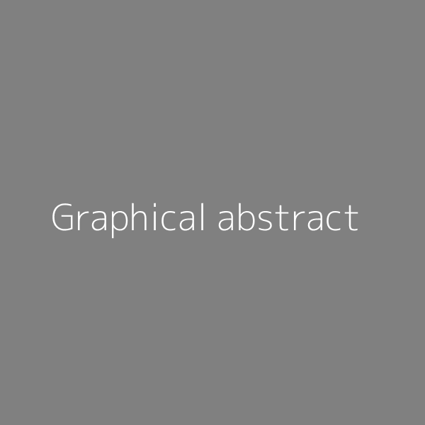

<!-- ── Pills buttons ──────────────────────────────────────────────────────── -->

::: {.d-flex .gap-2 .flex-wrap .mb-4}
[📄 Full Paper](https://doi.org){.btn .btn-outline-primary .btn-sm role="button"}
[📹 Video Demo](https://www.youtube.com){.btn .btn-outline-primary .btn-sm role="button"}
[🔗 GitHub](https://github.com){.btn .btn-outline-primary .btn-sm role="button"}
:::


# Core method {#sec-core-method}

{width=50%}

# Key results {#sec-results}

Possibly in a dense grid layout.


::: {.column-page layout-ncol=3}
{group="my-gallery"}

{group="my-gallery"}

{group="my-gallery"}
:::

# Full paper {#sec-paper}

```{=html}
<div style="max-width: 1000px;">
  <iframe
    src=".pdf"
    style="width: 100%; height: 1000px; border: 1px solid #e5e7eb; border-radius: 0.5rem;"
    allowfullscreen>
  </iframe>
</div>
```

# Supplementary {#sec-supplementary}

Follow the [IEEE guidelines for preparing supplementary materials](https://journals.ieeeauthorcenter.ieee.org/create-your-ieee-journal-article/prepare-supplementary-materials/).

* [Notebook 01](supplementary/01-notebook.html) is a Python notebook showing ...
* [Notebook 02](supplementary/02-notebook.html) is a Python notebook showing ...
* `Video.mp4` is a video showing ...

Zip archive: xxx MB.

# Citation {#sec-citation}

```bibtex
@article{doe2026dummy,
  title   = {A Dummy Article for Demonstration Purposes},
  author  = {Doe, John and Smith, Jane},
  journal = {Journal of LaTeX Examples},
  volume  = {42},
  number  = {3},
  pages   = {101--115},
  year    = {2026},
  doi     = {10.1039/dummyurl},
  url     = {https://example.com}
}
```
