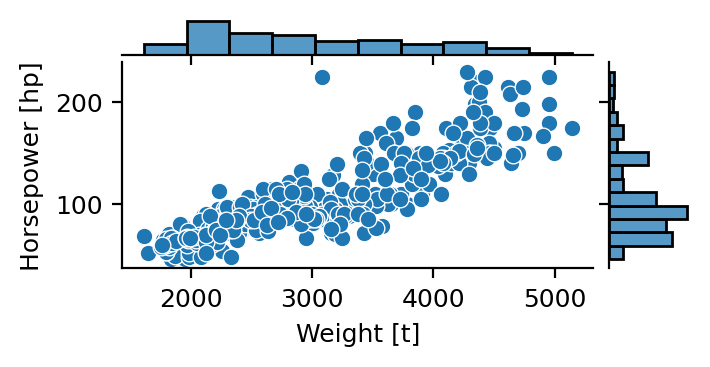

# Overview

## Minimum example
This minimum example contains all standard elements of a technical writing
to illustrate the formatting styles provided by the [quarto-tech-memo extension](https://github.com/gael-close/quarto-tech-memo).
Let's start with some math: $e^{\pi i} + 1 = 0$ is an inline equation, 
[In memo style, margin notes are supported, 
including small **inline** image.
{width=3cm} 
They shouldn't be used in 2-column paper style.]{.aside}
Eq. @eq-field is a numbered equation.
Here is some physical quantities using unicode: $B_\mathrm{noise}=15$\ μT/√Hz.
Note the "Narrow No-Break Space (NNBSP)" unicode `202F`. 

$$
\nabla \times \mathbf{B} = \mu_0 \mathbf{J} + \mu_0 \varepsilon_0 \frac{\partial \mathbf{E}}{\partial t} 
$$ {#eq-field}

<!-- Uncomment to populate with more dummy text 



::: {.wideblock}
{#fig-placeholder} 
:::
-->

## Figures and tables

Citations are included in IEEE style such as @close2022.
@fig-placeholder shows a numbered figure.
@tbl-placeholder is a numbered table.


{#fig-placeholder width=3in }

| Parameter             | Symbol          | Typ | Unit |
| :-------------------- | --------------- | --- | ---- |
| Hall sensitivity      | $S_\mathrm{H}$  | 0.2 | V/T  |
| Effective nr. of bits | $\mathrm{ENOB}$ | 12  | -    |

: Example of engineering table {#tbl-placeholder}




## Code snippet and callouts | Subtitle on the second line 

A title spanning two lines is often used in slide decks
to emphasize a full sentence.

Syntax highlighting is supported in code snippet too.
Callout boxes are available with appropriate icons or colors.

```python
def f(x, square=True):
    # Python code snippet
    return (x**2) if square else x
```

::: {.callout-note title="Markdown syntax"}
The manuscript is written in [Markdown](https://quarto.org/docs/authoring/markdown-basics.html), 
a plain-text **easy syntax**.
:::

## Dummy section

Lorem ipsum dolor sit amet, consectetur adipiscing elit. Donec semper leo nec quam aliquam consectetur.

<!-- 
 
-->

::: {.ignore}

# IGNORED 

## README

Adjust the following command to compile and publish.

```bash
quarto-tech-memo xxx.md
rclone copyto xxx.pdf "remote:.../Published Name.pdf"
```

Published file: [[Published Name.pdf|local]] | [Online](URL)


See this specific example to publish to Gdrive from Obsidian: [[2503 My Terminal Snippets#^md2memo]].

:::

